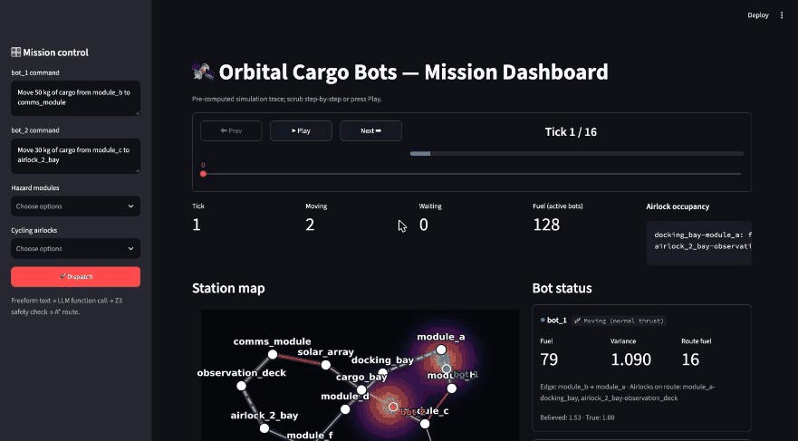

# Orbital Cargo Bots

An LLM dispatcher that manages two autonomous cargo bots on an orbital station. The LLM only interprets commands; every safety decision, route and schedule comes from classical algorithms (Z3, Dijkstra, a Kalman filter, Q-learning).



## What it does

Mission control types a freeform command, for example *"Move 50 kg of cargo from module_b to comms_module"*. The system then:

1. **Parses** it into a structured task with an LLM (OpenAI function calling, bot and module names pinned to enums).
2. **Routes** the task over the station graph, avoiding hazard modules where possible.
3. **Verifies** the planned route with Z3. Nothing executes unless the result is SAT.
4. **Replans** on UNSAT: every violated constraint is sent back to the LLM, which proposes an alternative (up to 3 attempts, then the request is rejected).
5. **Schedules** airlock crossings so the two bots never share a single-lane airlock.
6. **Executes** the plan tick by tick, with noisy position sensing and an adaptive pilot.

```
command ─▶ LLM parse ─▶ router ─▶ Z3 verifier ─▶ airlock scheduler ─▶ simulation ─▶ dashboard
              ▲                        │ UNSAT
              └──── replan with all ◀──┘
                    violated constraints
```

## Components

| Component | Module | Approach |
|---|---|---|
| Command interface and safety filter | `dispatcher.py`, `verifier.py` | OpenAI function calling, then Z3 checks of the routed request; UNSAT reasons drive the replan loop |
| Perception | `perception.py` | Dead-reckoning drift plus a 1D Kalman filter, with a fiducial fix on docking |
| Routing and conflict resolution | `routing.py` | Dijkstra on fuel cost (cluttered edges cost 2x), per-airlock reservation scheduler |
| Adaptive pilot | `adaptive_pilot.py` | Tabular Q-learning: cautious vs normal thrust on cluttered corridors |
| Memory | `db.py` | SQLite: inventory, bot status, task history, events |
| Dashboard | `dashboard.py` | Streamlit over a precomputed simulation trace |

`simulation.py` ties these together in two phases (plan, then execute) and returns a `SimulationTrace`.

### Safety rules (checked by Z3 against the real planned route)

- Destination mass capacity is not exceeded.
- Airlocks on the route are not mid-cycle.
- Origin, destination and route avoid hazard zones.
- The bot has enough fuel for the route.

All violated constraints are reported together, not just the first.

### Handling noise and contention

- **Noise.** There is no GPS in space. Each bot dead-reckons with drift; docking gives a clean fix; the Kalman filter fuses both into a believed position and an uncertainty.
- **Contention.** The station has two single-lane airlocks. A reservation scheduler (higher priority first, lower fuel breaks ties) books each crossing and the other bot holds at the node before the airlock. A runtime assertion fails if a slot is ever double-booked.

## Quick start

Requires Python 3.14.

```bash
python -m venv .venv
source .venv/bin/activate
pip install -r requirements.txt

cp .env.example .env     # then put your own OpenAI key in .env
```

No key ships with this repo. `dispatcher.py` reads `OPENAI_API_KEY` from the environment (via `python-dotenv`, which loads a local `.env`), or you can `export OPENAI_API_KEY=sk-...` for one session. `.env` is gitignored.

Without a working key the simulation still runs, using a mocked parse that returns each scenario's expected request.

```bash
# full pipeline, one shot (plan, schedule, every tick, final DB status)
python src/simulation.py

# live dashboard
streamlit run src/dashboard.py

# any module's self-check
PYTHONPATH=src python src/verifier.py
```

## Dashboard

The dashboard runs the simulation once and lets you scrub through (or auto-play) the trace. It shows:

- a KPI row summarising the run;
- the station map with each bot's true position, believed position and an uncertainty heatmap sized by Kalman variance;
- a timeline / Gantt of ticks and airlock reservations;
- fuel and variance charts;
- a per-tick panel showing what dispatch, verifier, router, scheduler, pilot and filter did;
- controls to add hazard modules, mark airlocks as cycling, and send a command to either bot, which re-runs the whole pipeline;
- a tab for the pilot's learned Q-table.

## Tests and evaluation

```bash
python tests/test_core.py    # verifier branches, station shape, hazard detour,
                             # default run (fuel 64/35, finish tick 16), cycling-airlock rejection
python eval/evaluate.py      # verifier accuracy on 9 labelled requests + simulation metrics
```

Both mock the LLM call, so they need no API key and are deterministic. Current results:

| Metric | Result |
|---|---|
| Verifier accuracy (9 labelled requests) | 9/9 |
| Default simulation finish tick | 16 |
| Rejected requests in default run | 0 |

Noise is seeded (`random`, `numpy`), so runs are reproducible apart from the live LLM parse.

## Project layout

```
.
├── README.md
├── requirements.txt           # pinned versions
├── .env.example               # copy to .env and add your own key
├── assets/demo.gif            # dashboard demo
├── eval/evaluate.py           # verifier accuracy + simulation metrics
├── tests/test_core.py         # offline tests (LLM call is mocked)
└── src/
    ├── station.py             # 17-module station graph, 2 airlocks
    ├── db.py                  # SQLite schema + persistence
    ├── verifier.py            # Z3 safety checks
    ├── dispatcher.py          # LLM command parsing + replan loop
    ├── perception.py          # dead reckoning + Kalman filter
    ├── routing.py             # Dijkstra routing + airlock reservations
    ├── adaptive_pilot.py      # Q-table
    ├── simulation.py          # plan + execute, produces SimulationTrace
    └── dashboard.py           # Streamlit UI
```

## Limitations

- **Verification is plan-time only.** Masses are committed when the plan is made, not when cargo physically moves. Hazards and cycling airlocks are static inputs for a run.
- **The verifier only knows its constraints** (mass, airlock state, hazards, fuel). Anything else is unchecked. The LLM itself is never trusted: its output is schema-constrained and nothing runs unless Z3 returns SAT.
- **Replans depend on the live LLM**, so outcomes after a rejection can vary between runs.
- **Simplified world.** Movement is node-to-node on a graph with a 1D Kalman filter, not real physics. The Q-table is trained on synthetic rewards, so its thrust preference is weak.
- **Greedy airlock scheduling** is not globally optimal and can make a bot wait longer than necessary.
- **Mock fallback.** If the OpenAI call fails, the simulation prints a warning and uses the mocked parse, so a demo run is not evidence that the live LLM path works.

## Possible next steps

Dynamic hazards, re-verification at execution time, a real motion model, and a non-greedy scheduler.
